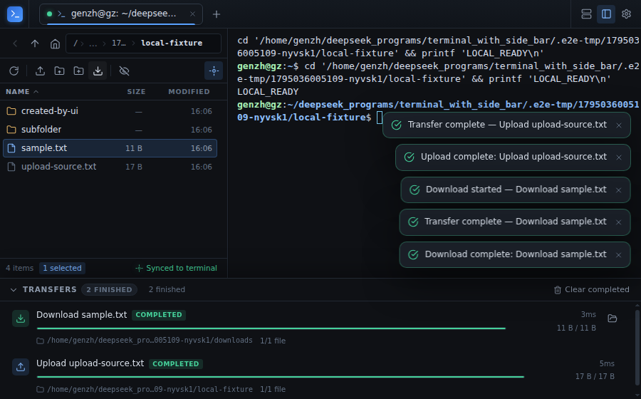

# TermShelf

**A terminal with a MobaXterm-style file sidebar — local and over SSH, for Windows and macOS.**

TermShelf pairs an xterm.js terminal with a file browser that follows the shell's working
directory. Drag files from Explorer/Finder onto the sidebar to transfer them into the folder
shown by the terminal; select files in the sidebar and download them to any folder you pick.
Connect over SSH and the same sidebar becomes an SFTP browser for the remote machine, with
uploads, downloads, progress, cancellation and conflict handling.

Built with Electron, React, xterm.js, node-pty and ssh2. One codebase produces native
Windows and macOS builds.



## Features

- **Terminal first** — real PTY (ConPTY on Windows, forkpty on macOS), ANSI-256/truecolor,
  10k scrollback, resizable, tabs that keep their scrollback when hidden, configurable font
  size, clickable links, copy/paste and right-click menu.
- **File sidebar synced to the shell** — the folder view follows `cd` through OSC 7 shell
  integration. Supported shells: bash, zsh, fish and PowerShell. A per-tab toggle switches
  between "follow terminal" and manual browsing; the editable path bar covers unsupported
  shells (`cmd.exe`, `sh`).
- **Drag-and-drop transfer** — drop OS files _or folders_ onto the sidebar to copy them into
  the terminal's folder (upload over SFTP for SSH sessions). Drop on a folder row to target
  that folder. The same pipeline powers the **Upload files…** / **Upload folder…** buttons.
- **Download anywhere** — multi-select files/folders, pick a destination folder, and receive
  a recursive transfer with live progress; the last destination is remembered and a quick
  action reuses it. Remote sessions stream through SFTP.
- **Real SSH sessions** — profile manager (password, private key + passphrase, or SSH agent),
  explicit host-key trust with SHA-256 fingerprints and mismatch blocking, keepalives,
  reconnect, saved profiles, and per-session SFTP on the same connection.
- **Transfers you can control** — aggregate and per-file progress, cancel with partial-file
  cleanup (`.part` files are removed), overwrite/skip/keep-both/conflict prompts, filename
  sanitization for Windows-invalid names, and best-effort mtime preservation.
- **Security defaults** — sandboxed renderer with context isolation, typed/zod-validated IPC,
  CSP, no Node integration in the renderer, secrets encrypted with the OS keychain/DPAPI via
  `safeStorage` (never stored in plaintext), and no secrets ever sent to the renderer.


## Quick start

Requirements: **Node.js 22.12+** and **pnpm 11**.

```bash
pnpm install
pnpm dev            # Electron + Vite dev server
```

Build the production bundles and run them:

```bash
pnpm build
pnpm start          # electron-vite preview
```

### Try SSH locally with the bundled demo server

`tools/dev-sshd` is a small ssh2-based SSH server with a sandboxed SFTP subsystem and a real
PTY shell. It is a development/demo fixture (not hardened) and binds to loopback only.

```bash
# Terminal A — serves demo-remote/ as the SSH root
pnpm dev:sshd --root demo-remote --port 2222 --user demo --password demo --sftp-path-mode absolute

# Terminal B — in the app: New SSH Session → 127.0.0.1:2222, demo / demo
```

`--sftp-path-mode absolute` exposes real paths under the root, which matches the pty shell's
`$PWD` so remote-folder following (OSC 7) works end-to-end. The default `virtual` mode maps
the root to `/` and is what the integration tests use for sandbox-path coverage.

### Checks

```bash
pnpm typecheck      # main + preload + renderer, no emit
pnpm lint           # ESLint 10 + typescript-eslint
pnpm test           # unit + integration (Vitest), incl. in-process SSH/SFTP server
pnpm test:e2e       # Playwright + Electron, headless, real local and SSH flows
pnpm format:check   # Prettier
```

The end-to-end suite launches the real built app with an isolated profile, verifies terminal
input, CWD-following, new-folder, upload and download on local sessions, then connects to the
in-process demo SSH server, trusts its host key, browses/transfers over SFTP and verifies
remote `cd` folder sync.

## Builds

| Platform    | Artifact                                    | How                                                                                        |
| ----------- | ------------------------------------------- | ------------------------------------------------------------------------------------------ |
| Windows     | Portable `.zip` (unsigned)                  | `pnpm build && pnpm exec electron-builder --win zip` — cross-buildable from Linux/macOS    |
| Windows     | NSIS `.exe` installer (unsigned by default) | GitHub Actions **release** workflow on `windows-latest`, or run `pnpm dist:win` on Windows |
| macOS       | `.dmg` + `.zip`, arm64 and x64              | GitHub Actions **release** workflow on `macos-latest`, or `pnpm dist:mac` on a Mac         |
| Linux (dev) | `.AppImage`                                 | `pnpm dist:linux`                                                                          |

The repository's `.github/workflows/release.yml` builds all three on a `v*` tag (or manual
dispatch) and uploads artifacts. Builds are unsigned unless signing secrets are configured —
see [docs/BUILDING.md](docs/BUILDING.md) for signing, notarization and CI details.

Artifacts produced and verified in this checkout:

- `dist/TermShelf-0.1.0-linux-x86_64.AppImage` — built and smoke-tested headlessly.
- `dist/TermShelf-0.1.0-win-x64.zip` — Windows x64 portable build (PE32+ verified; cannot be
  executed on this Linux host).
- The macOS `.dmg`/`.zip` must be built on macOS (or the provided CI workflow); macOS
  packaging is not possible on Linux.

## Architecture

```
src/renderer        React 19 + zustand + xterm.js 6; tabbed terminals, file sidebar,
                    dialogs, transfer drawer. Sandboxed, talks to main through a typed preload.
src/preload         contextBridge API (window.termshelf) + webUtils.getPathForFile for DnD.
src/main            Electron main process:
  sessions/         LocalSession (node-pty) and SshSession (ssh2 pty + SFTP), session manager
  files/            FileBackend contract: LocalBackend and SftpBackend
  transfers/        scan → plan → conflict policy → streams → progress/cancel/cleanup
  shell/            per-shell init scripts for clean OSC 7 CWD reporting
  store/            atomic JSON config: settings, profiles, encrypted secrets, known hosts
  security/         SHA-256 host-key fingerprinting
src/shared          IPC contract, zod schemas, shared types/constants
tests/              unit, integration (dev-sshd fixture), Playwright e2e
tools/dev-sshd      demo/test SSH + SFTP server
```

Path handling is centralized in the main process: local sessions use the host path rules
(including Windows drive and UNC roots), SSH sessions use POSIX/SFTP paths, and the renderer
never constructs filesystem paths itself.

## Platform notes and limitations

- **Windows**: PowerShell 7 (`pwsh`) or Windows PowerShell is the default shell and gets
  folder sync; `cmd.exe` works in manual-folder mode. Downloads sanitize Windows-illegal
  characters and reserved device names. Unsigned builds show SmartScreen warnings.
- **macOS**: zsh/bash/fish login shells get folder sync (a generated `ZDOTDIR` preserves
  user startup files). Unsigned apps must be opened with right-click → Open (or after
  clearing quarantine). Browsing protected folders (Desktop/Documents/Downloads) may trigger
  the standard macOS privacy prompts.
- **SSH**: Linux/macOS remotes support remote-folder sync over bash/zsh/fish. Windows OpenSSH
  remotes work for the terminal and SFTP; remote-folder sync falls back to manual browsing.
  Shell integration is best-effort: if SFTP, shell detection or init-file verification fails,
  the session falls back to a plain shell and the sidebar remains fully usable manually.
- **Scope for v1**: no jump hosts/port forwarding/X11, no built-in editor, no upload
  resume/retry, no drag-out to the desktop, no session restore on launch, no light theme, no
  WSL/Git-Bash as _local_ shell backing (they remain valid SSH targets). Keyboard-interactive
  auth is limited to a single non-echo password prompt.
- Electron bundle size is ~100 MB; terminal rendering uses xterm's DOM renderer for stability
  (WebGL can be added later).

## Security

- Renderer: `sandbox: true`, `contextIsolation: true`, no `nodeIntegration`, strict CSP in
  packaged builds, navigation/window-open denied, external links restricted to http(s).
- IPC: sender validation, channel whitelist, zod validation on every payload.
- Credentials: main process only; saved passwords/passphrases are encrypted with
  `safeStorage` (Keychain/DPAPI). If encryption is unavailable (e.g. a Linux box without a
  keyring) TermShelf never persists the secret and asks on each connection.
- Host keys: trust-on-first-use with a visible SHA-256 fingerprint; unknown keys are blocked
  until explicitly trusted and a changed key is a hard error that requires forgetting the old
  key. Known hosts and profiles live in the app's `userData` directory.
- The demo SSH server is a development fixture: loopback only, demo credentials, not hardened.

## Documentation

- [docs/BUILDING.md](docs/BUILDING.md) — prerequisites, native modules, packaging matrix,
  signing/notarization, CI, troubleshooting.
- [docs/QA.md](docs/QA.md) — Windows 11 and macOS acceptance checklist, including host-key
  flows, drag-and-drop, transfers, secrets-at-rest checks and the demo server.

## License

UNLICENSED / proprietary by default. Add a license before distributing. The application
bundles Electron, Chromium, xterm.js, ssh2 and node-pty; their licenses are included in the
packaged app's license files.
